# Roles, Tenancy, and Access Control

**Status:** Design decision memo. Decisions recorded, nothing built yet.
**Date:** 2026-09-06 (v2 — the six open questions from v1 are now answered and folded in)
**Companion docs:** [product.md](product.md) §5 (data model, "Roles, tenancy, and access control"), §10 (MVP phases), §11 (pricing), [CHECKLIST.md](CHECKLIST.md) (roadmap seams)

---

## TL;DR — the six recommendations

1. **Don't design a seniority ladder. Derive the ladder from a capability matrix.** Your five-role sketch was close, but two rungs existed for reasons that don't survive the actual capability list, and one capability that genuinely needs separating wasn't in the sketch at all.
2. **Ladder: Owner → Admin → Manager → Contributor → Viewer.** Five rungs, single owner, strictly nested. "Super Admin" dropped — the real cut between the two admin tiers is *security policy* vs *people management*.
3. **Review authority does not belong on the ladder.** Approve/request-changes is the capability a regulated buyer will demand be separable (maker–checker). Capability overlay, not a sixth rung.
4. **Access control is two layers, not one.** *Everyone sees a case exists and how far along it is. Not everyone can read what's inside it.* This is the single most important decision in this document, and it makes the ACL dramatically cheaper than the usual row-level-filtering design.
5. **Tenancy: `Organization → Workspace`. Two levels, not three.** No `Team` as a structural level. The workspace stays the hard isolation boundary, which `scoped()` already enforces.
6. **Build the seam, not the feature.** Ship the ladder and the ACL now. Add `workspace.organization_id` (nullable) and the `resolveRole()` indirection now. Build zero organization UI until an enterprise deal is real. Same posture the codebase already takes with `signature_envelope`, `visibility_condition`, and the `auth_level` ladder.

**Decisions recorded in this revision:** Viewer gets no file download by default (grantable) · Contributors may approve by default (restrictable per workspace) · cross-workspace carry-forward is an enterprise feature, and splits into two very different things · roles are **never** a paywall — billing is per seat · case-level ACL is a **must**, scoped to content rather than existence · no Gather-staff role in the model at all.

---

## Part 1 — What exists today

```
workspace_role = pgEnum('workspace_role', ['owner', 'member'])
workspace_member = { workspaceId, userId, role, createdAt }
requireRole(session, 'owner' | 'member')
```

Three observations that shape everything below:

- **`member` currently means "full access."** So when roles are renamed, `member` migrates to **Contributor**, not Viewer. Reusing the word `member` for a read-only spectator would silently downgrade every existing user *and* contradict what "member" means in every SaaS product your buyers already use.
- **`scoped(workspaceId)` is the strongest existing invariant** — the ESLint rule banning raw `db` imports makes workspace isolation structural rather than remembered. Nothing in this document weakens it. The ACL in Part 6 is a *second, narrower* layer **inside** the workspace boundary, never a replacement for it.
- **There is no permission indirection.** Before adding rungs, route everything through a single `can(session, capability, resource)`. That one function is what turns every remaining decision here from a refactor into a config change.

---

## Part 2 — Derive roles from capabilities, not from seniority

A rank list feels obvious and then produces roles nobody can define, because "what's the difference between super admin and admin?" has no answer until the capability list is written. So:

| # | Capability | Blast radius if misused |
| --- | --- | --- |
| C1 | Billing, plan changes, payment method, seat count | Financial |
| C2 | Delete workspace, transfer ownership | Catastrophic, irreversible |
| C3 | Security policy — retention, default auth level, data residency, SSO | Compliance / regulatory |
| C4 | Integrations, API keys, webhooks | Data exfiltration surface |
| C5 | Invite / remove members | Access control |
| C6 | Change member roles | Privilege escalation |
| C7 | Create / edit / archive templates | Process integrity |
| C8 | Publish a template version | Process integrity, org-wide |
| C9 | Create / edit / cancel cases | Operational |
| C10 | Add parties, issue / revoke recipient links | **External** — reaches real people |
| C11 | Send now, edit message copy, override reminder policy | **External** — reaches real people |
| C12 | Review: approve / request changes | **Substantive** — the product's judgement call |
| C13 | Read case **content** — files, answer values, party contact details | **Confidentiality** — PAN cards, bank statements, candidate CVs |
| C14 | Export packet ZIP | Confidentiality, in bulk |
| C15 | View audit log | Oversight |
| C16 | View cases and dashboard — existence, progress, status | Baseline |
| C17 | Grant / revoke another user's content access to a case | Access control, case-scoped |

Three things fall out of this list that a rank ladder would have hidden:

**C12 (review) is not administrative, it's substantive.** In an accounting practice the senior partner approves and never touches settings. In a bank, the person who chased the vendor must frequently *not* be the person who accepts the document — maker–checker, and an audit finding if you can't demonstrate it. Neither shape is expressible on a rank ladder.

**C13 and C16 are different capabilities, and separating them is the whole ACL.** "Can you see that Case #482 is 3-of-7 complete and overdue" is a completely different question from "can you open the PAN card inside it." Every product that conflates these ends up with either a useless dashboard or a confidentiality breach. Part 6 builds on this split.

**C17 exists because someone must be able to widen access, and that act must be visible.** It's a capability in its own right, not a side effect of being senior.

---

## Part 3 — The naming problem

| Original name | Problem |
| --- | --- |
| **Super Admin** | Nobody remembers which of super-admin/admin ranks higher. Worse: in SaaS it usually means *the vendor's own staff* impersonation role. Keeping the name unused avoids a future collision. |
| **Admin** (as the second tier) | Fine alone, wrong as a *pair*. Two roles differing only by an intensifier can't be told apart in a dropdown without a paragraph of help text. |
| **Collaborator** | Not wrong — GitHub uses it — but it names a *relationship* rather than a *job*. |
| **Member** | Actively misleading. Everywhere else (Slack, Notion, Linear, GitHub) "member" is the **default full-participation** role. Using it for a read-only spectator inverts the user's existing mental model and contradicts the current schema. |

| Rung | **Set A — chosen** | Set B — domain-flavoured | Set C — original sketch |
| --- | --- | --- | --- |
| 1 | Owner | Owner | Owner |
| 2 | Admin | Administrator | Super Admin |
| 3 | Manager | Case Manager | Admin |
| 4 | Contributor | Case Handler | Collaborator |
| 5 | Viewer | Observer | Member |

**Set A, chosen.** Boring is right for permissions — every word already means the correct thing to anyone who has used Slack or Notion, so the UI needs no explanation. Set B reads better inside a bank but locks the vocabulary to one vertical, fighting product.md §1's "horizontal engine, vertical marketing" decision. *Case manager* is a literal job title in the ICP, so "Manager" lands intuitively for an accounting practice and a bank branch alike.

---

## Part 4 — The role model

### The ladder

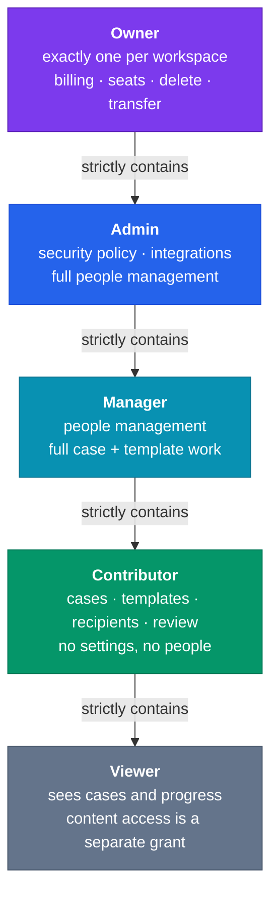

**The ladder is strictly nested.** Every rung is a superset of the one below. That's a deliberate constraint: the moment two roles overlap without nesting, the UI has to explain a Venn diagram and `can()` stops being a comparison. Anything that doesn't nest goes in the overlay (Part 5) or the ACL (Part 6).

### The cut lines, named

| Boundary | What crosses it | Why it's the right cut |
| --- | --- | --- |
| Owner / Admin | Money and existence — billing, seats, plan, delete workspace, transfer ownership | Legal and financial accountability lands on one identifiable person. Contractually, this is who signed. |
| Admin / Manager | **Security and compliance policy** — retention, auth ladder, residency, SSO, API keys, webhooks | The honest version of the "super admin vs admin" instinct. Not seniority: *can you change the rules the workspace operates under, or only operate within them?* |
| Manager / Contributor | **People** — invite, remove, change roles | A branch lead onboards their own staff; a case handler doesn't. |
| Contributor / Viewer | **Any action that changes state or reaches an external person** | The one bright line a recipient can feel. A Viewer can never cause an email to arrive at a client. |

### Permission matrix

| Capability | Owner | Admin | Manager | Contributor | Viewer |
| --- | :---: | :---: | :---: | :---: | :---: |
| C1 Billing, plan, seats | ✅ | ❌ | ❌ | ❌ | ❌ |
| C2 Delete workspace, transfer ownership | ✅ | ❌ | ❌ | ❌ | ❌ |
| C3 Security policy — retention, auth level, residency, SSO | ✅ | ✅ | ❌ | ❌ | ❌ |
| C4 Integrations, API keys, webhooks | ✅ | ✅ | ❌ | ❌ | ❌ |
| C5 Invite / remove members | ✅ | ✅ | ✅¹ | ❌ | ❌ |
| C6 Change member roles | ✅ | ✅¹ | ✅¹ | ❌ | ❌ |
| C7 Create / edit / archive templates | ✅ | ✅ | ✅ | ✅ | ❌ |
| C8 Publish template version | ✅ | ✅ | ✅ | ✅² | ❌ |
| C9 Create / edit / cancel cases | ✅ | ✅ | ✅ | ✅ | ❌ |
| C10 Add parties, issue / revoke recipient links | ✅ | ✅ | ✅ | ✅ | ❌ |
| C11 Send now, message copy, reminder overrides | ✅ | ✅ | ✅ | ✅ | ❌ |
| C12 **Review — approve / request changes** | ✅ | ✅ | ✅ | ✅³ | ❌ |
| C13 **Read case content — files, answers, party PII** | ⚙️⁴ | ⚙️⁴ | ⚙️⁴ | ⚙️⁴ | ❌⁵ |
| C14 Export packet ZIP | ⚙️⁴ | ⚙️⁴ | ⚙️⁴ | ⚙️⁴ | ❌ |
| C15 View audit log | ✅ | ✅ | ✅ | ❌ | ❌ |
| C16 View cases, dashboard, progress | ✅ | ✅ | ✅ | ✅ | ✅ |
| C17 Grant / revoke case content access | ✅ | ✅ | ✅ | ❌ | ❌ |

¹ **Grant ceiling rule** — you may only assign a role at or below your own. A Manager can create Contributors and Viewers, never Admins. Without this, C5+C6 is a one-click escalation path to Admin and the ladder is decorative.
² Publish is grouped with edit at launch. If a regulated customer asks for draft/publish separation, split it — `template_version.status` already supports it.
³ **Decided: yes by default.** A workspace setting `require_separate_reviewer` enforces maker–checker for regulated customers by rejecting `review.reviewed_by == case.created_by`.
⁴ Not a flat yes. Gated by the case ACL in Part 6 — the role makes you *eligible*, the ACL decides.
⁵ **Decided: Viewer gets no content access by default, and it is grantable.** A Viewer sees that the PAN card was submitted and approved; they do not see the PAN card.

### Rules the matrix doesn't capture

1. **Exactly one Owner, enforced in the database** — partial unique index on `workspace_member (workspace_id) WHERE role = 'owner'`. A constraint, not application logic: application logic loses a race.
2. **Ownership transfer must be atomic.** Old owner demotes to Admin in the same transaction the new owner is promoted. A half-completed transfer produces zero-owner or two-owner workspaces, and zero-owner is unrecoverable without a support script.
3. **Owner cannot leave or delete their account until they transfer.** Hard block, with a message pointing at the transfer flow.
4. **Self-demotion is blocked for the last Admin.** A workspace must refuse to reach a state with nobody who can manage people.
5. **Removing a member never deletes their work.** `case.created_by` references `user.id`; the audit trail must survive offboarding. Deactivate the membership, don't cascade.
6. **Role changes are audit events**, written in the same transaction as the change, per the project's existing rule ("never a background write, or it did not happen").

### Ownership transfer

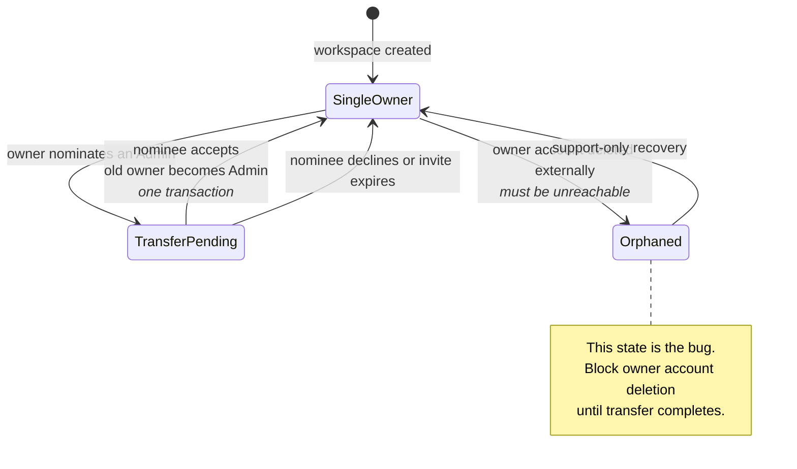

---

## Part 5 — What does NOT go on the ladder

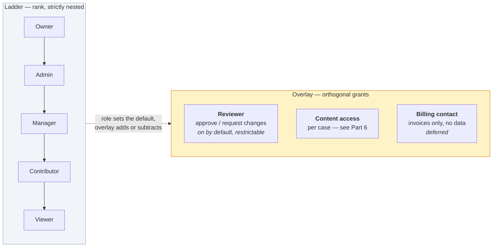

**Reviewer (C12).** Two real shapes: the accounting partner who reviews but administers nothing, and the bank where creator ≠ approver is mandatory. Neither is expressible on a rank ladder; both are trivial as an overlay. Concretely, a nullable `capabilities jsonb` column on `workspace_member` where `null` means "role defaults apply," plus a workspace-level `require_separate_reviewer` flag. Roughly a day of work *given* `can()`, and roughly a fortnight without it.

**Billing contact.** Enterprise buyers routinely have a finance person who must receive invoices and must never see a case — *below* Viewer on data, *above* Admin on billing. Pure ladder can't express it. Not building it now; noting that the overlay is where it lands.

**One important non-role: the recipient.** Parties are outside this model entirely — no `user` row, no membership, no role. Their authorisation is `access_token` + `auth_level`, a separate ladder that already exists. Worth stating explicitly, because "what role does the vendor have?" is asked by every new engineer and every enterprise security reviewer, and the answer — *none, structurally, by design* — is one of the product's better talking points (§3.1).

**And one role that deliberately does not exist: Gather's own staff.** No impersonation role, no support tier, nothing in this model. If support ever needs to see a customer's data, that gets designed then, as its own heavily-audited thing. "Super Admin" stays an unused name partly for this reason.

---

## Part 6 — Case-level access control

This is the section that changed most, and the framing that makes it tractable came from one sentence: *"I can look at a case, and its progress, but not the content of it."*

That sentence is the design. It separates one question everyone conflates into two:

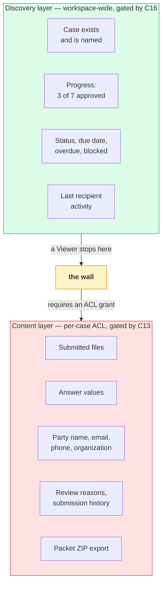

### Why this split is worth so much

The obvious design — "restricted cases disappear from lists for people who lack access" — turns every list query into a permission-filtered query, breaks dashboard counts, makes "why can't I find case 482?" unanswerable, and is exactly the complexity jump that gets an ACL deferred forever.

Splitting discovery from content avoids all of it:

- **List and dashboard queries do not change at all.** No permission filter, no join, no N+1 explosion on top of the N+1s already flagged in CHECKLIST's known gaps. `scoped()` remains the only filter.
- **Enforcement collapses to five chokepoints** instead of being smeared across every read path.
- **"Who is blocking the close" still works for everyone**, which is the dashboard's entire job per §9 — and it works without leaking a single document.
- **The failure mode is legible.** A user sees the case, sees a lock, and knows who to ask. They are never left guessing whether something exists.

### The five chokepoints

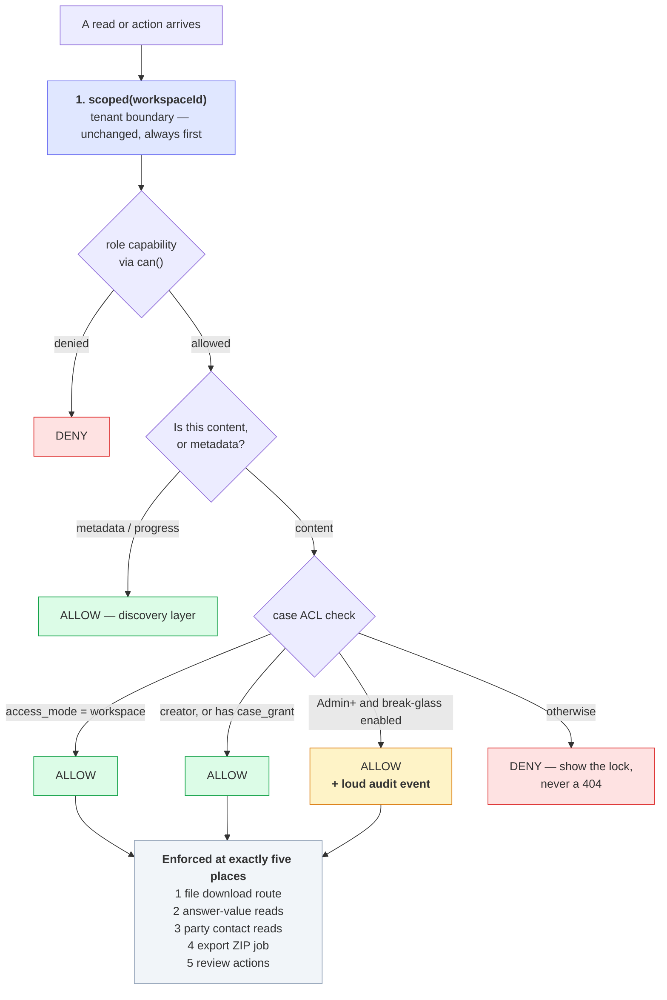

Chokepoint 5 is a pleasing consequence rather than an extra rule: **you cannot review what you cannot read.** C12 therefore composes with the ACL for free — the reviewer overlay grants the *authority*, the ACL grants the *access*, and both are required.

### Access modes, set on the template and snapshotted onto the case

Two modes, inherited at instantiation using the same snapshot-then-independent pattern the codebase already uses for requirement definitions and reminder policy:

| Mode | Who can read content | The customer it's for |
| --- | --- | --- |
| **`workspace`** (default) | Anyone with C13 eligibility — Contributor and above | The accounting practice. Five people, everyone works every client, an ACL would be friction with no benefit. |
| **`restricted`** | The case creator, plus explicit `case_grant` rows, plus break-glass | HR candidate documents. Bank branch cases. Anything where "a colleague can open this" is a hard no. |

Editing a template's default mode later never reaches into a live case — same posture as everywhere else in this schema.

### Break-glass: how Admins get in

The tempting simple answer is "Owner and Admin always see everything." That's what most SaaS does, and it's wrong for the driving example: a workspace admin who can read every candidate's CV is exactly the thing HR won't accept.

The opposite extreme — admins locked out permanently — creates unrecoverable cases when the creator leaves.

So: a workspace setting, with an honest default.

- `admin_implicit_content_access: true` (**default**) — Owner/Admin read restricted cases directly. Right for a five-person accounting firm, where the alternative is ceremony with no threat model behind it.
- `admin_implicit_content_access: false` — Owner/Admin can *grant themselves* access (they hold C17), but doing so writes a distinct, prominent audit event and is surfaced in the case's activity history. Access is never silently available; it is always available, and always visible.

That second mode is the standard break-glass pattern, and it's what an enterprise security reviewer actually wants to see — not "admins can't," which nobody believes, but "admins can, and you'll know."

### Entities

```
workflow_template.default_access_mode   enum('workspace','restricted')  default 'workspace'
case.access_mode                        enum('workspace','restricted')  -- snapshotted at instantiation

case_grant {
  id, workspace_id, case_id, user_id,
  granted_by, granted_at, revoked_at,
  reason text null,          -- required when break-glass self-granting
  source enum('explicit','break_glass')
}

workspace.admin_implicit_content_access  boolean  default true
workspace.require_separate_reviewer      boolean  default false
```

`case_grant` carries `workspace_id` like every other table, so it goes through `scoped()` unchanged.

### Two details that will otherwise bite

**The case name can itself be the leak.** "Candidate: Priya Sharma — Senior Engineer" in the discovery layer defeats the entire point for the HR use case. A `restricted` case therefore redacts the **party display name** in discovery views, showing the case's own name and a generic party label. The requester naming a case badly is a training problem, not a schema one, but the party name is structured data and must be handled.

**Requirement titles leak too, and less obviously.** A list of requirement titles — "Bankruptcy declaration," "Medical certificate" — reveals a lot without any file being opened. For `restricted` cases, discovery shows *counts and statuses only* ("4 of 7 approved, 1 needs changes"), never the per-requirement titles. That keeps the dashboard's actual job — who is blocking the close — fully intact, because that answer is a count and a party, not a list of document names.

---

## Part 7 — Tenancy: Organization, Workspace, Team?

### Model A — Flat workspace (today)

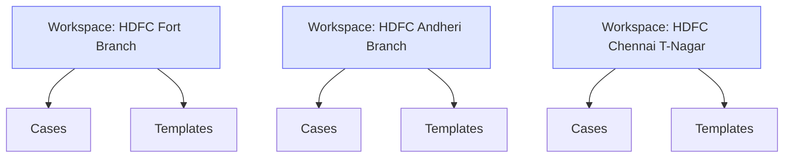

**Where it breaks:** the central compliance officer needs 400 separate invitations. The KYC template is copy-pasted 400 times and drifts. There are 400 subscriptions and 400 invoices. There's no answer to "how many vendor packets are outstanding across the bank?" You can't close that deal — not because of a missing feature, but because the shape of the product doesn't match the shape of the buyer.

### Model B — Organization → Workspace ✅ chosen

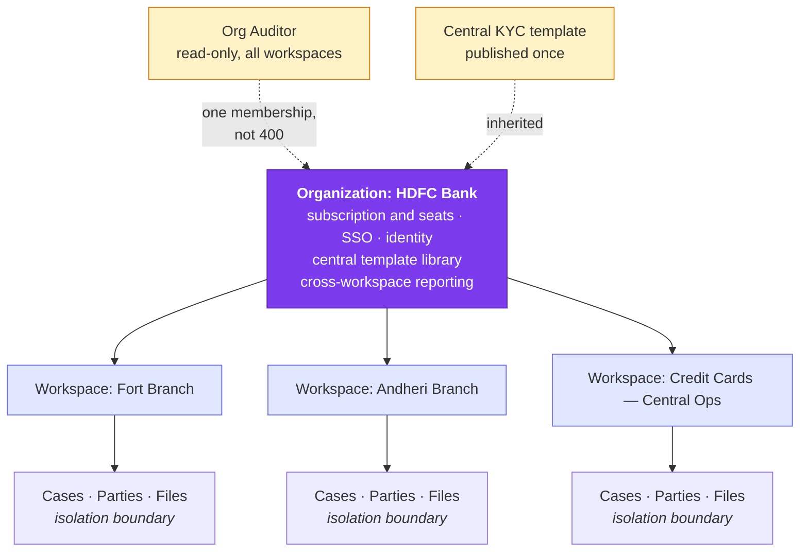

- **The workspace stays the hard isolation boundary.** Fort branch cannot see Andheri's customer documents. Exactly what a bank wants, and exactly what `scoped()` already enforces — so this model costs nothing architecturally.
- **It solves the four things Model A can't**, and only those: one subscription, one identity surface, one central template library, cross-workspace read for auditors.
- **It's dormant for the launch ICP.** An accounting practice is one org with one workspace and never sees the word "organization."

### Model C — Organization → Workspace → Team/Project ❌

**Rejected.** The third level looks free and isn't. Its cost is permission *resolution*: a user who is Contributor at org, Admin at workspace, and Viewer at team is a real situation you must define, and every "most permissive wins" / "most specific wins" rule will be wrong for some customer and unexplainable in a UI.

Note what the original examples were: "credit card team," "account opening team." Ask the load-bearing question about each — **should account-opening staff be able to read the credit-card team's submitted documents?** If no, that's a *workspace*. If yes, it's a *label* — or, now, a `restricted` case. Neither answer is a third hierarchy level.

### The heuristic worth writing on the wall

> **A workspace boundary is drawn wherever a document-visibility wall belongs *for a whole group of cases at once*. Nothing else.**
>
> Not org charts, not geography, not billing, not reporting lines — those are attributes of a workspace, not reasons to create one. And a wall around *one* case is a `restricted` case, not a new workspace.

That last clause is new in v2 and it matters: the ACL absorbs a large class of "should this be its own workspace?" questions that would otherwise fragment a customer's data for no reason.

### "Team" and "Project" — where those words go

- **"Team" as an assignment target** — a named bag of users a case can be routed to, so "the KYC desk" gets a queue. Grouping for *routing*, not isolation. Additive and safe; grants nothing on its own. It does become a useful `case_grant` target later (grant a team, not fifteen people).
- **"Project" as a grouping of cases** — a label or a saved view. `WorkflowTemplate` already does most of what people mean by it: "Q3 Vendor Onboarding" is a template plus a date filter.

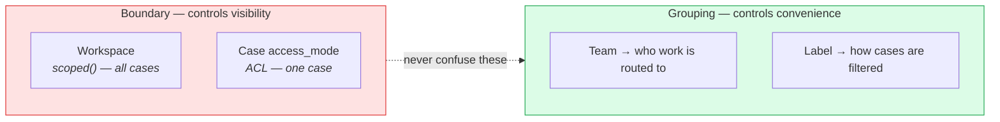

Conflating them is the most common way multi-tenant permission models rot: a "team" that started as a routing convenience quietly becomes a visibility rule, and then nobody can safely change either.

### Org-level roles — three, deliberately not a mirror of the ladder

| Org role | Capabilities | Effect inside workspaces |
| --- | --- | --- |
| **Org Owner** | Subscription, seats, SSO, create/delete workspaces, appoint Org Admins | Implicit Owner everywhere |
| **Org Admin** | Central template library, org-wide security policy, workspace provisioning | Implicit Admin everywhere |
| **Org Auditor** | Read-only across all workspaces, full audit log | Implicit Viewer + C15 everywhere — **and no implicit C13**, so restricted-case content still requires a grant or break-glass |

That last cell is the point where the ACL and the org model have to agree, and they do: an org auditor can see every case in every branch and read none of the confidential ones without leaving a trace.

Everyone else has **no org role**, and only the workspace memberships they were explicitly given. That's the common case and should stay the default.

### Resolution: how a permission check actually runs

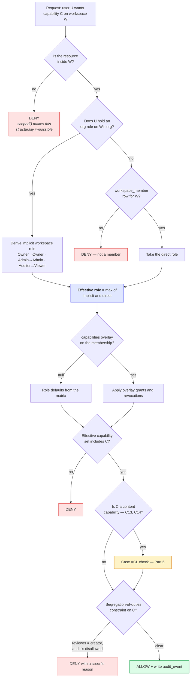

**"Max of implicit and direct" is the only merge rule, deliberately.** No subtraction, no most-specific-wins. If an org auditor is also a workspace Manager, they're a Manager there. One rule statable in a sentence beats a rule that's subtle and correct.

Today this whole flowchart collapses to: *look up `workspace_member`, compare to the matrix.* Which is the point — the shape is right, and the org half is unreachable code until an org exists.

---

## Part 8 — The bank scenario, worked

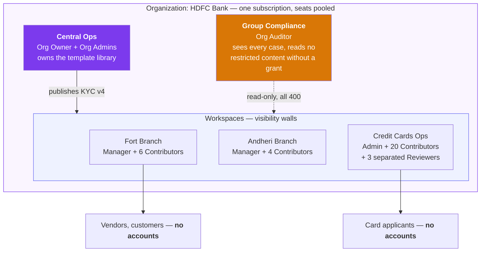

| Requirement | Where it lands | Real cost |
| --- | --- | --- |
| One contract, one invoice | `organization` owns the subscription and the seat pool | Small |
| SSO / SCIM | Org-level identity; `auth_level` ladder untouched | Real but standard; already the Enterprise tier in §11 |
| Central template governance | Org template library, workspaces inherit versions | Moderate — `template_version` is already versioned |
| Branch A can't see Branch B | **Already done.** `scoped()` | Zero |
| Group compliance reads all | Org Auditor role | Small — one union query |
| Maker–checker on approvals | Reviewer overlay + `require_separate_reviewer` | Small, *given* `can()` |
| Confidential cases inside a branch | `access_mode = restricted` + `case_grant` | Part 6 — built for Phase 1b anyway |
| Cross-branch reporting | Org dashboard = union over workspaces | Moderate |

**Worth noticing:** the hardest requirement — hard tenant isolation — is already built, and built structurally rather than by convention. Everything else is additive. That's why the org level can wait: it isn't load-bearing for the thing that would have been expensive to retrofit.

**And what should worry you instead:** none of this is what blocks a bank deal. What blocks it is the security questionnaire, the pen-test report, SOC 2 or ISO 27001, the DPA, residency in ap-south-1, and a 3–6 month procurement cycle. §1 already reaches the right conclusion — *this is not your first customer.* Build the seam so the deal is possible in year two.

---

## Part 9 — Carry-forward across workspaces

**Decision: yes, and it is an enterprise feature.** But it is two features wearing one name, and separating them is what makes it sellable to a bank instead of fatal in security review.

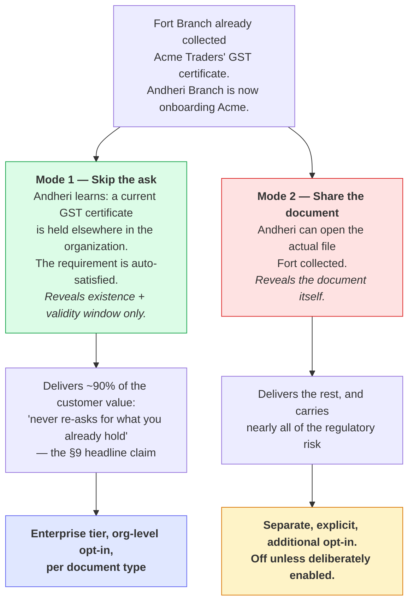

**Mode 1 is where the value is.** The persuasive sentence in §9 — *"never re-asks for what you already hold"* — is fully satisfied by Mode 1. The client's experience of not being asked twice is identical either way. Mode 2 only benefits the requester's convenience, and it's the half a bank's data-segregation policy is most likely to forbid outright.

### How this works without breaking the boundary

- `ledger_subject.workspace_id` **stays exactly as it is.** The scoping invariant is untouched.
- An org-level link table maps workspace-local ledger subjects to a shared organization subject: `org_ledger_link { organization_id, org_subject_id, workspace_id, ledger_subject_id }`. Carry-forward in `organization` mode resolves through this link; in `workspace` mode (the default, and the only mode without an org) it never touches it.
- **Configured per document type, not globally.** "A GST certificate carries across branches; a customer's bank statement does not" is a sentence a compliance officer will actually want to write, and a single org-wide on/off switch can't express it.
- **Audit events land in both workspaces.** The workspace that skipped the ask records why; the workspace that holds the document records that its holding was consulted. An auditor tracing either side finds the whole story.
- **Mode 1 must not become a content backdoor.** A requirement satisfied by carry-forward shows *satisfied, held elsewhere, valid until <date>* — it does not become a link into the other workspace's file. Opening that file is Mode 2, and Mode 2 goes through the same ACL as anything else.

### The interview question this replaces

The v1 doc flagged this as something to ask customers. It's now a product decision, but one question survives and is worth asking anyway, because the answer shapes how they'll draw workspaces: **"When your Chennai branch onboards a vendor Mumbai already cleared, should Chennai have to ask again?"** The answer tells you whether they think of branches as one institution or many, which is the same information you'd need to advise them on workspace boundaries.

---

## Part 10 — Packaging: roles are never a paywall

**Decision: charge per seat. Every role is available on every plan.**

This resolves the packaging risk v1 flagged — gating a role behind a tier means demoting existing users when they downgrade, which is the worst kind of packaging change. Buying a seat buys a *person*, and the customer assigns whatever role they want to it. Nothing in Parts 4–6 is ever a purchasing decision.

**One flag, because it's a real factor rather than an objection.** product.md §11 currently says the opposite about the *primary* metric: *"Charge primarily by active packets, completed packets, or active external entities. Avoid seats as the primary value metric."* The reasoning there is sound — value scales with cases completed, not with headcount, and seat-based pricing in this category punishes exactly the customer you want (one that rolls the tool out widely).

Those two positions are reconcilable, and product.md has been updated to the reconciliation rather than left in contradiction:

| Unit | What it prices | Why |
| --- | --- | --- |
| **Active packets / cases** | The value metric — what the tier is sized by | Scales with the work the product actually does (§11's original reasoning, preserved) |
| **Seats** | Internal users, priced per head | The customer's stated model; keeps roles ungated and makes team expansion a clean, predictable upsell |
| **External recipients** | Always free, always unlimited | Non-negotiable — charging for recipients contradicts the entire §3.1 thesis |

**And one consequence worth pre-empting: don't charge a full seat for a Viewer.** A Viewer exists to give a partner, a compliance officer, or a manager visibility. If that costs the same as a Contributor, customers simply won't add them — and org-wide visibility is precisely what makes the product sticky and what drives expansion revenue later. Free or heavily discounted Viewer seats, capped at some multiple of paid seats, cost almost nothing to serve (they change no state and, by default, read no content) and buy a great deal of account penetration. Recommended, not decided — it's a pricing experiment, not an architecture question.

---

## Part 11 — What this means for the schema

Following the codebase's established seam discipline:

### Build now — the ladder

```
workspace_role: ['owner','admin','manager','contributor','viewer']
                 -- migrate existing 'member' → 'contributor'

workspace_member
  + capabilities  jsonb null              -- null = role defaults; the overlay seam
  + status        enum active|deactivated -- offboard without cascading work
  + invited_by    text null

partial unique index on workspace_member(workspace_id) where role = 'owner'

workspace
  + require_separate_reviewer      boolean default false
  + admin_implicit_content_access  boolean default true
```

And, the part that actually matters:

```
can(session, capability, resource?) -> boolean
```

One function. Every server action and route goes through it. It replaces `requireRole` entirely — a ladder gated by `requireRole(session,'owner')` scattered across call sites is a ladder you can't change.

### Build now — the ACL

```
workflow_template.default_access_mode  enum('workspace','restricted') default 'workspace'
case.access_mode                       enum('workspace','restricted')  -- snapshotted
case_grant { id, workspace_id, case_id, user_id, granted_by, granted_at,
             revoked_at, reason, source enum('explicit','break_glass') }
```

Enforced at the five chokepoints in Part 6 — file download, answer reads, party contact reads, export job, review actions — and **nowhere else**, because discovery deliberately stays unfiltered.

### Build now — the tenancy seam only

```
organization                 id, name, billing_plan, seat_count, sso_config, created_at
workspace + organization_id  uuid null references organization(id)
```

`organization` ships empty; `organization_id` stays null for every workspace. No org UI, no org roles table, no org membership, no `org_ledger_link`. The value is entirely in the migration you don't have to run later — back-filling a parent onto live workspaces, re-parenting billing, and rewriting every permission call site *simultaneously* is the expensive version, and it always happens under deal pressure.

### Do not build yet

Org UI · org roles · `org_ledger_link` and cross-workspace carry-forward · teams · custom roles · billing-contact role · field-level permissions · anything for Gather's own staff.

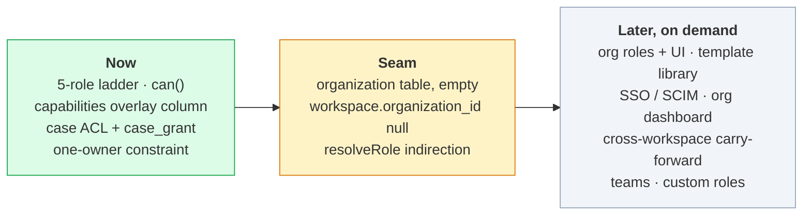

### Entity view

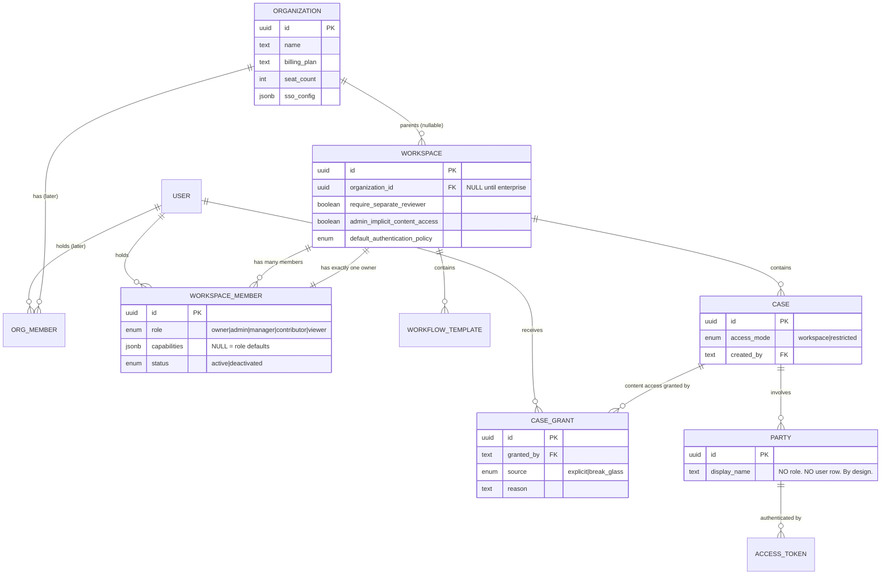

---

## Part 12 — Decisions, and what's still open

### Resolved

| # | Question | Decision |
| --- | --- | --- |
| 1 | Does Viewer include file download? | **No by default, grantable.** Viewer sees state, not documents. |
| 2 | Can Contributors approve? | **Yes by default**, with `require_separate_reviewer` to enforce maker–checker where it matters. |
| 3 | Does carry-forward cross workspaces? | **Yes, as an enterprise feature** — and split into Mode 1 (skip the ask) and Mode 2 (share the document), with Mode 2 requiring its own explicit opt-in. See Part 9. |
| 4 | Are roles a paid feature? | **No. Never.** Per-seat billing; every role on every plan. See Part 10. |
| 5 | Per-case access control? | **Yes, a must** — as a content ACL, not visibility filtering. Discovery stays workspace-wide. See Part 6. |
| 6 | Where does Gather's own staff sit? | **Nowhere.** Not modelled. Designed separately if it's ever genuinely needed. |

### Still open

- **Should Viewer seats be free or discounted?** (Part 10.) A pricing experiment, not an architecture question — the schema doesn't care either way.
- **Does `restricted` need to be settable per case, or only inherited from the template?** Template-only is simpler and covers the HR and bank shapes cleanly, since those are template-shaped workflows. Per-case override is a small addition if a customer asks. Starting template-only.
- **Do `case_grant`s expire?** Time-boxed access ("this auditor, for 30 days") is a natural enterprise ask and a nullable `expires_at` column away. Not adding it until someone asks, but the column shape is obvious enough that retrofitting is cheap.
- **How do the ACL and export interact for a multi-party case?** A packet ZIP spanning several parties where content access differs per party is a real edge. Deferred alongside multi-party assignment itself (Phase 1b).

---

## Part 13 — Sequencing

| When | What | Why then |
| --- | --- | --- |
| **Next stage** | `can()` + capability matrix, replacing `requireRole` | Cheapest now, most expensive later. Every other decision here depends on it. |
| **Next stage** | 5-role enum, `member`→`contributor` migration, one-owner constraint, ownership transfer | Small. The transfer flow is a real gap today — a single-owner model without transfer is a support incident waiting to happen. |
| **Next stage** | `capabilities jsonb`, `require_separate_reviewer`, `admin_implicit_content_access` columns — unused | Three nullable/defaulted columns now vs. a migration under deal pressure later. |
| **Phase 1b** | Role management UI, invitations, grant-ceiling enforcement | Pairs naturally with the notification centre — same "the team, not just me" surface. |
| **Phase 1b** | **Case ACL** — `access_mode`, `case_grant`, the five chokepoints, the lock-not-404 UI | Needs Stage 6/7 to exist first (there's no content to protect until uploads and reviews are real), and must land before the first customer with genuinely confidential cases. |
| **Phase 1b** | `organization` table + nullable FK, both dormant | Ship it before there's data to back-fill. |
| **Phase 1.5** | Reviewer overlay enforcement, break-glass audit surfacing | Maker–checker becomes real when compliance verticals arrive, which is what Phase 1.5 targets. |
| **First enterprise deal** | Org roles, template library, SSO, org dashboard, cross-workspace carry-forward | Not before. Roles are not what blocks that deal — SOC 2 and procurement are. |

---

## Appendix — the one-paragraph version

Gather has one hard boundary (**workspace**, already enforced by `scoped()`), one rank ladder inside it (**Owner → Admin → Manager → Contributor → Viewer**, strictly nested, exactly one Owner, never a paywall — seats are what's sold), one overlay for what rank can't express (**review authority**, and eventually a billing-only contact), one per-case ACL that guards **content but never existence** (everyone sees a case and its progress; only granted users open what's inside), and one dormant parent for enterprises (**Organization** — a nullable FK and an empty table until someone pays for it, at which point it also unlocks cross-workspace carry-forward). Recipients are outside all of it and always will be. The only thing that genuinely must be built first is `can()`, because that's what turns every remaining decision from a refactor into a config change.
